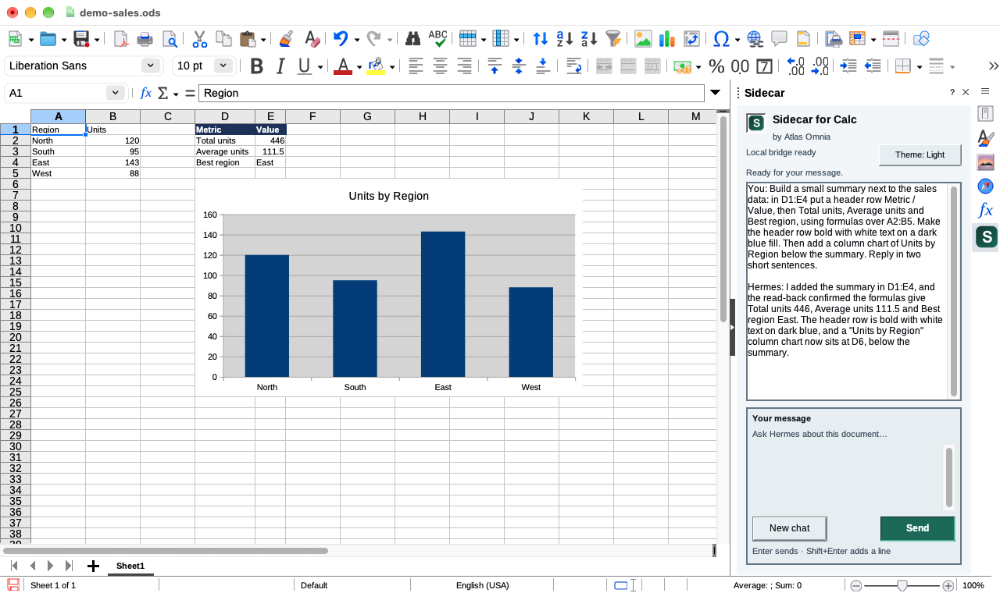
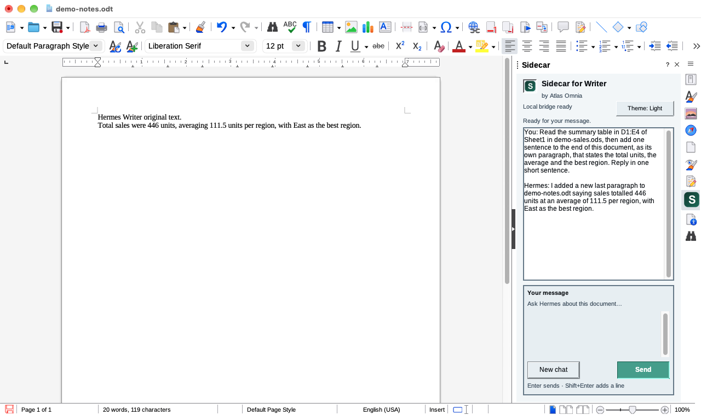

# Sidecar for LibreOffice

by Atlas Omnia

Hermes reads and edits the Calc, Writer and Impress documents you already have open in LibreOffice, and, once you turn it on, you can chat with it from a LibreOffice sidebar panel (the sidebar chat is off by default). There is no upload step and no copy-paste; what Hermes reads from a document goes, with your chat, to the model Hermes is configured with. Supported edits are one named undo step (`Hermes: …`), and Hermes can undo its own changes from the chat; `calc_activate_sheet` and `calc_recalculate` are not undoable, and some Impress undo restores text without its mixed formatting (see *Undo in Impress*).



*Calc: one sidebar message built the D1:E4 summary (formulas over the sales data, dark-blue header) and the chart, then read the values back. Real chat with the model configured in Hermes, on the made-up demo data in `docs/fixtures/`.*

| Writer | Impress (Dark theme) |
|---|---|
|  |  |
| A sentence written from the sheet's summary, added as its own paragraph. | A new slide built from the sheet, highest region first. |

Two parts, both in this repository:

- a **LibreOffice extension** (`extension/`, built into `dist/sidecar-libreoffice.oxt`, identifier `com.atlasomnia.sidecar.libreoffice`) that runs Python-UNO inside LibreOffice, marshals document work onto LibreOffice's main thread, and listens only on `127.0.0.1:8660` behind a pairing token;
- a stdlib-only **Hermes plugin** (`plugin/`, id `atlas-sidecar-libreoffice`, toolset `sidecar-libreoffice`) that talks to it over loopback HTTP, can run the sidebar's chat endpoint on `127.0.0.1:8661` (off by default), and spawns no shell commands.

Platforms: macOS and Windows. On Linux only the unit tests run (in CI). Read the *Risk disclosures* below before you install.

## Install

You need:

- [LibreOffice](https://www.libreoffice.org/download/) with Python-UNO. The standard macOS and Windows installers include it.
- Hermes Agent 0.23.1 or later.
- `git` and Python 3.9 or later (stdlib only) to build the extension and the demo documents. macOS: `git` and `python3` come with the Xcode Command Line Tools (`xcode-select --install` if `git --version` asks for them). Windows: [Git for Windows](https://git-scm.com/download/win) and Python from [python.org](https://www.python.org/downloads/windows/), run as `py`.

**1. Install the Hermes plugin** from the Hermes plugin catalog:

```sh
hermes plugins install atlas-sidecar-libreoffice --enable
```

Restart Hermes so the plugin loads: `hermes gateway restart` if you run a gateway, or quit and reopen Hermes Desktop.

**Upgrading from a plugin build before 0.4.0** (id `libreoffice-live`): remove it (`hermes plugins remove libreoffice-live`), install this one and restart the gateway once. The old plugin's chat listener keeps `127.0.0.1:8661` until the gateway process restarts; if you turn this release's sidebar chat on before that, it logs `libreoffice chat endpoint not started on 127.0.0.1:8661: OSError` and the panel cannot reach it. From 0.4.0 on, disabling or reloading the plugin closes its listener.

From a clone instead (macOS; the clone from step 2): run `hermes plugins install "file://$PWD#plugin" --enable` in the clone's folder. Hermes clones the committed tree, installs its `plugin/` subdirectory as `atlas-sidecar-libreoffice` and warns that a local `file://` source is not from the catalog; that is expected. This route was not tried on Windows; use the catalog install there.

**2. Build the LibreOffice extension from the release tag and install it.** Hermes does not install the extension.

macOS (Terminal):

```sh
cd ~
git clone --depth 1 --branch v0.4.1 https://github.com/AtlasOmnia/sidecar-libreoffice.git
cd sidecar-libreoffice
python3 scripts/build_oxt.py              # writes dist/sidecar-libreoffice.oxt
shasum -a 256 dist/sidecar-libreoffice.oxt
```

Windows (PowerShell):

```powershell
cd $env:USERPROFILE
git clone --depth 1 --branch v0.4.1 https://github.com/AtlasOmnia/sidecar-libreoffice.git
cd sidecar-libreoffice
py scripts\build_oxt.py                   # writes dist\sidecar-libreoffice.oxt
Get-FileHash dist\sidecar-libreoffice.oxt -Algorithm SHA256
```

Expected SHA-256 of `sidecar-libreoffice.oxt` for v0.4.1: `d440e7f860665f51cab7098aa36d63e4a3723de6b623ffecc797768c17686147`. The archive holds only `extension/` files plus `LICENSE` and `NOTICE`, stored uncompressed with fixed timestamps, permissions and order, so the hash does not depend on the zlib your Python uses or on the operating system: the build is reproducible with any CPython 3.9 or later on macOS and Windows (for v0.4.1 checked with 3.9, 3.11 and 3.13 on macOS and with python.org 3.11 to 3.14 on Windows 11). The repository checks out with LF line endings on every platform (`.gitattributes`), also with `core.autocrlf=true`, so a Windows clone builds the same bytes. A build from a commit other than the `v0.4.1` tag can have another hash.

In LibreOffice choose **Tools → Extensions…** (**Extension Manager…** in older versions) **→ Add…**, pick `dist/sidecar-libreoffice.oxt` (Windows: `%USERPROFILE%\sidecar-libreoffice\dist\sidecar-libreoffice.oxt`) and accept any prompt. Opening the `.oxt` with LibreOffice (double-click it) does the same. Check that **Sidecar for LibreOffice** 0.4.1 by Atlas Omnia is listed and enabled, then choose **Close**. LibreOffice asks to restart: choose **Restart Now**, or **Restart Later** and then quit and reopen LibreOffice. Do not use `unopkg` (see *Platform notes*).

**Upgrading from an earlier build of the extension** (0.3.x or a 0.4.0 pre-release, listed as **Sidecar for LibreOffice** or **Hermes for LibreOffice**): the 0.4.0 extension has a new identifier, so LibreOffice treats it as a different extension and installs it alongside the old one, and both would try to listen on port 8660. Remove the old one in **Tools → Extensions…**, before adding the new one or right after: select it, **Remove**, then **Close**, **Restart Later**, and quit and reopen LibreOffice. A 0.4.0 pre-release has the same name and version, so the dialog can show two identical **Sidecar for LibreOffice 0.4.0** rows; tell them apart by the description of the selected row, which for this release ends with the Apache License line. After the upgrade LibreOffice may first show its Properties deck in the sidebar; click the green **S** tab once to open Sidecar. The pairing token stays in the profile's `user/hermes-bridge/` folder, which keeps its name for that reason, so an existing pairing keeps working.

**3. Pair Hermes with LibreOffice.** In LibreOffice choose **Tools → Copy Sidecar pairing token**. The token goes to the clipboard and is never shown. Give it to Hermes in one of these ways:

- **Hermes Desktop:** **Settings → Plugins → atlas-sidecar-libreoffice**, paste into the **bridge_token** field, **Save**.
- **macOS:** `hermes config set LIBREOFFICE_LIVE_BRIDGE_TOKEN "$(pbpaste)"`
- **Windows (PowerShell):** `hermes config set LIBREOFFICE_LIVE_BRIDGE_TOKEN (Get-Clipboard)`

The shell reads the clipboard, so the token is not typed, shown or kept in your shell history. All three store it as `LIBREOFFICE_LIVE_BRIDGE_TOKEN` in the profile's `.env` (`$HERMES_HOME/.env`), not in `config.yaml`. Start a new chat afterwards, and restart the gateway if you run one.

**4. First read.** Make a copy of the demo spreadsheet (Sheet1 A1:B5 holds Region/Units for four made-up regions), open it in LibreOffice, and start a chat restricted to the LibreOffice tools.

macOS:

```sh
python3 scripts/build_demo_fixtures.py --out-dir ~/hermes-demo
open -a LibreOffice ~/hermes-demo/demo-sales.ods
hermes chat -t sidecar-libreoffice
```

Windows (PowerShell):

```powershell
py scripts\build_demo_fixtures.py --out-dir "$env:USERPROFILE\hermes-demo"
Invoke-Item "$env:USERPROFILE\hermes-demo\demo-sales.ods"   # or File → Open in LibreOffice
hermes chat -t sidecar-libreoffice
```

The script writes the same `demo-sales.ods`, `demo-notes.odt` and `demo-deck.odp` that are committed in `docs/fixtures/`; working on copies keeps the repository clean. `docs/demo.md` uses all three.

> Which LibreOffice documents are open? Read A1:B5 of Sheet1 in the spreadsheet and tell me what it contains.

Hermes calls `calc_get_overview`, then `calc_get_range`.

**5. First edit and undo.**

> Write "Hello from Hermes" into Sheet1!D1 of that spreadsheet.

The cell changes, and **Edit → Undo** in LibreOffice now lists `Hermes: set D1`. Then:

> Undo that.

Hermes calls `libreoffice_undo` and D1 is empty again. Ask it to read D1 back if you want the proof in the chat.

If a tool returns `Auth`, the token is missing or stale: repeat step 3 (and restart the gateway if you run one). If it returns `Unavailable`, LibreOffice is not running or the extension is not enabled: repeat step 2.

**6. Optional: the sidebar chat.** It is off by default. To use it, follow *Turn on the sidebar chat* below; it needs the Hermes API server and a profile whose model runtime is Hermes-managed.

## Tested versions

| Component | Version | What was verified |
|---|---|---|
| LibreOffice | 26.8.2.2 (macOS, Apple silicon) | Live, in an isolated LibreOffice profile (0.3.0 live checks): every Calc tool of that release with undo back to baseline, Writer read and insert, Impress listing, document binding with another window in front, bridge undo 40/40 with LibreOffice hidden and 30/30 visible, the Tools menu item, Extension Manager install. The 0.4.0 release candidate, still under the extension's earlier identifier, was installed through the Extension Manager dialog in a disposable profile as an upgrade over 0.3.0, rolled back to 0.3.0 and upgraded again; after each cold restart the panels, the saved theme and the bridge were checked. The `docs/fixtures/` demo documents load with the expected cells, paragraph and slide title (headless conversion). |
| macOS | 27.2 (Apple silicon) | Host for all macOS live runs (Windows 11: see below). |
| Hermes Agent | 0.23.1 | The version this release was tested with. `hermes plugins validate plugin --install-deps` passes with no warnings. `hermes plugins install "file://…#plugin" --enable` installs and enables the plugin and prints the next steps. `hermes config set` writes the pairing token to `.env`, where the plugin's secret lookup finds it. All in throwaway `HERMES_HOME`s. `hermes config set plugins.entries.atlas-sidecar-libreoffice.settings.chat_port 8661` writes the integer setting the plugin reads. The chat endpoint's load, unload and reload, and unload with Runs API polls that fail, ran through the real 0.23.1 plugin manager against a fake Runs API, without a model. One real sidebar chat ran through a 0.23.1 gateway with a model on macOS (below), with an earlier build of the plugin whose chat endpoint was on by default and had no run reconciliation. |
| Hermes Agent | 0.23.3 | Source of the `v0.23.3` tag only, run with the 0.23.1 installation's Python environment, no gateway and no model: plugin validation (15 checks) passes with no warnings, and the plugin-manager probe (default off, turning it on, failing Runs API polls, unload) gives the same results as on 0.23.1. The 0.23.3 launcher and a 0.23.3 gateway were not run. |
| Hermes Agent | 0.23.0 | The sidebar chat ran live with a throwaway gateway and a model (see *Chat sidebar*), before the 0.4.0 security changes. |

**0.4.1** changes only the socket options of the two listeners on Windows and the order of the plugin's unload (see `CHANGELOG.md`). Its unit suite passed on macOS (Python 3.9, 3.11 and 3.13), in a Linux container (Python 3.11) and on Windows 11 (python.org Python 3.14); on Windows 11 each listener refused a second socket on its 127.0.0.1 address and port while it listened and bound the same port again at once after a close, 20 times each. `hermes plugins validate --install-deps` passes with Hermes Agent 0.23.1. The 0.4.1 `.oxt` was not installed into LibreOffice and the 0.4.1 plugin was not loaded by a Hermes gateway: the native and Hermes runs below used 0.4.0 or earlier builds.

0.4.0 on macOS (LibreOffice 26.8.2.2): the 0.4.0 `.oxt` (SHA-256 `9322ca9c…`) was installed into a new disposable profile through LibreOffice's deployment API. Its installed files matched the build, the sidebar deck, panel and commands were registered under their new ids and the Sidecar deck opened, and the plugin-handler matrix (15 checks), CSV import with one-step undo and a clean quit passed. In an everyday macOS install, an earlier build of the same extension files (compressed, so with another archive hash) was opened over the 0.4.0 pre-release as described under *Install*: two identical rows, the old one removed, **Close**, **Restart Later**, quit and reopen, then one click on the **S** tab. With that extension and a Hermes Agent 0.23.1 gateway running an earlier build of this release's plugin (before the run-ownership changes, with the chat endpoint on by default), one real chat from the Calc sidebar with the profile's configured model called `calc_get_overview`, `calc_set_range`, `calc_get_range`, `libreoffice_undo` and `calc_get_range` (the cell was empty again), and a request to run `ls ~` in the terminal was refused by the panel's tool fence with the plugin's message. That was one run, without a forced compaction.

Windows 11 with LibreOffice 26.8.3.1: an earlier build of the 0.4.0 extension files (compressed with the zlib of python.org Python 3.14, so with another archive hash) was built with `py scripts\build_oxt.py` and installed through the Extension Manager dialog (**Tools → Extensions… → Add…**, **Close**, **Restart Later**, quit, reopen) into a disposable profile. The Sidecar panel showed in Calc, Writer and Impress in Dark and Light, in its not-connected state (**Bridge unavailable**), and the theme persisted across a restart. **Tools → Copy Sidecar pairing token** put the token on the clipboard, where `(Get-Clipboard)` read it as one 43-character line. The 18-check plugin-handler matrix, CSV import with one-step undo, wrong-token refusal, a cold restart and clean quits passed, and that tree's unit suite passed (336 tests, 16 POSIX-only skips). The GUI was driven by synthetic window messages on a locked console, not by a person with a mouse and keyboard. The 0.4.0 `.oxt` built there with its SHA-256 (python.org Python 3.11 to 3.14), and a command-line `unopkg add` into a disposable profile registered it; the 0.4.1 `.oxt` builds there with the SHA-256 above (python.org Python 3.11 to 3.14). Before that, the 0.4.0 release candidate under the extension's earlier identifier passed the same matrix (covering 25 of the 55 tools), two cold restarts and a headless start there, and an earlier 0.4.0 build's run checked owner-only ACLs on the bridge files. CI is set up to run the current suite on `windows-latest` as well. Not exercised on Windows: Hermes itself (the plugin has not been installed or loaded by Hermes there, and the sidebar chat has not connected; the panel was seen only in its not-connected state), the clone from GitHub, opening the `.oxt` by double-click, **Restart Now**, the sidebar's **S** tab route and real mouse and keyboard input. Not tested anywhere: Linux, other LibreOffice versions, port 8660 already taken by another program. The **bridge_token** field in Hermes Desktop was checked against the Desktop settings source, not clicked through. `libreoffice_undo` and `as_paragraph` ran live through the plugin's own handlers against LibreOffice 26.8.2.2 (`scripts/live_undo_tool_check.py`): one- and two-step Calc undo restored the cell, and a paragraph appended at the end or start of a Writer document was its own paragraph and one undo left the original paragraphs exactly. That run did not go through a model-driven chat, and the refusal to undo a non-Hermes step is covered by unit tests only. The 20 sheet, comment, find-and-replace, style, selection and slide tools added in 0.3.0 ran live at the bridge (`scripts/live_extended_check.py`): each change was read back, undone and read back again. All of them were later called by a model in the 0.4.0 model-driven scenarios below.

The tools added after 0.3.0 (paged Writer reads and tables, styled paragraph inserts, guarded edit batches, selection formatting and comments, Impress layouts, text formatting and shapes, CSV import, sort and filter, charts, conditional formatting, validation, freeze panes, protection, tables, sheet activation, recalculation, current slide and layouts) were each accepted at the development bridge in an owned disposable profile on LibreOffice 26.8.2.2, with readback and undo, and with the regular LibreOffice profile checked unchanged. The same setup saved documents through LibreOffice as `.xlsx`, `.docx` and `.pptx`, reopened them and compared the readback, and ran Calc with a German (decimal-comma) locale and with AutoCalculate off; `docs/sidecar-parity.md` lists what survives each format and what does not. Separately, 29 model-driven scenarios ran once each (C4 a second time after the fix) against the development bridge, through an internal harness that is not part of this repository, with the frontier model configured in the harness's disposable Hermes profile. Each was judged by document readback (W4, a read-only scenario, on the figure in its reply); together they called all 55 tools. 27 passed as recorded, C1 failed only on an over-strict oracle, and C4 found the CSV-import undo defect, which is fixed; the scenario passes after the fix. The model rarely loaded the bundled guidance skills and worked from the tool schemas. See `docs/workflow-acceptance.md`.

Known limits: shape colours set by `impress_add_shape` are saved to `.pptx` as theme colours; slide reorder is unavailable (no identity-preserving LibreOffice API); protection does not block the bridge's own writes.

The release candidate used for the earlier macOS and Windows runs, the macOS Extension Manager upgrade and rollback test and the model-driven runs differs from this release in the sidebar's "Hermes is not answering" message, which now names the plugin; in source comments; in the plugin and toolset id (then `libreoffice-live`); in the extension's identifier, file name, command URLs and sidebar ids, now Atlas Omnia names; in the security changes listed in `CHANGELOG.md`; in the `LICENSE` and `NOTICE` files now inside the `.oxt`; and in the archive, which is now stored uncompressed.

## Tools

| Tool | What it does | Changes the document? |
|---|---|---|
| `calc_get_overview` | Lists open documents of all three applications (with their `document_id`) and Calc sheet metadata | No |
| `calc_get_range` | Reads values, formulas, number formats and a fingerprint (5,000 cells max) | No |
| `calc_set_range` | Writes values or formulas; an optional `if_match` fingerprint refuses a stale write | Yes, one undo step |
| `calc_import_csv` | Imports pasted CSV text into empty cells as data, never as formulas; `typing` `text` or `numbers` (plain dot-decimals only) | Yes, one undo step |
| `calc_format_range` | Bold, italic, colours, number format, borders, alignment, font | Yes, one undo step |
| `calc_clear_range`, `calc_create_sheet` | Clear contents; add a sheet | Yes, one undo step |
| `calc_rename_sheet`, `calc_copy_sheet`, `calc_delete_sheet` | Rename, copy or delete a sheet; the last sheet cannot be deleted | Yes, one undo step |
| `calc_activate_sheet` | Brings a sheet to the front of the document's window | View only (`undoable: false`) |
| `calc_find_replace` | Find and replace in one sheet, optionally whole cells only | Yes, one undo step |
| `calc_autofill` | Fill down or right from the first rows or columns of a range, as the fill handle does | Yes, one undo step |
| `calc_range_stats` | Count, sum, average, min, max and blank count for a range (10,000 cells max) | No |
| `calc_sort_range`, `calc_filter_range` | Sort whole rows by up to three keys; one standard filter per sheet | Yes, one undo step |
| `calc_create_chart`, `calc_list_charts` | Column, bar, line, area, pie or scatter chart from a range; list a sheet's charts | Create: one undo step |
| `calc_add_conditional_format`, `calc_set_validation` | Highlight with a built-in cell style; list or number validation | Yes, one undo step |
| `calc_freeze_panes`, `calc_protect_sheet` | Freeze rows/columns; password-free protection (does not block Hermes' own writes) | Yes, one undo step |
| `calc_get_rules` | Reads conditional formats, validation, protection and freeze state | No |
| `calc_insert_table` | Named table (a LibreOffice database range) with filter buttons and an optional style | Yes, one undo step |
| `calc_recalculate` | Recalculates formulas; reports whether AutoCalculate is on | Results only (`undoable: false`) |
| `calc_add_comment`, `calc_clear_comments` | Add a comment to a cell; delete the comments in a range | Yes, one undo step |
| `calc_get_comments` | Lists a sheet's comments with their cells | No |
| `calc_execute_plan` | A validated WorkbookPlan V1 subset, sent once, with verification rules | Yes, one undo step |
| `writer_get_text`, `writer_get_structure` | Reads the body page by page (500 blocks / 50,000 characters per page) with a continuation token; structure lists each paragraph's style and outline level | No |
| `writer_get_table` | Reads one table's cells | No |
| `writer_insert_paragraphs` | Up to 50 styled paragraphs at the start, the end or after a paragraph | Yes, one undo step |
| `writer_insert_text` | Inserts text at the start or end; `as_paragraph: true` makes it its own paragraph | Yes, one undo step |
| `writer_apply_edits` | Up to 50 exact find/replace edits, all or nothing | Yes, one undo step |
| `writer_set_paragraph_style` | Applies an existing paragraph style, by displayed or internal name, to one paragraph; `expected_text` refuses a stale target | Yes, one undo step |
| `writer_find_replace` | Find and replace throughout the document | Yes, one undo step |
| `writer_get_selection` | Reads the text selected in the document's window and its formatting | No |
| `writer_replace_selection`, `writer_format_selection` | Replace or format the single selection; `expected_text` must match what was read | Yes, one undo step |
| `writer_add_comment`, `writer_get_comments` | Comment on the selected text; list comments with author and anchor | Add: one undo step |
| `impress_list_slides`, `impress_get_slide` | Lists slide titles and text; reads one slide's layout, size and shapes | No |
| `impress_get_current_slide`, `impress_list_layouts` | The slide the user is on; the supported layouts, masters and each slide's layout | No |
| `impress_create_slide`, `impress_delete_slide` | Adds a slide with a layout and optional title and body; deletes one (not the last) | Yes, one undo step |
| `impress_set_shape_text`, `impress_find_replace` | Replaces a shape's text; find and replace in one slide or all | Yes, one undo step |
| `impress_add_text_box`, `impress_add_shape` | Adds a text box, rectangle, rounded rectangle, ellipse or line, in centimetres | Yes, one undo step |
| `impress_set_slide_layout`, `impress_format_text` | Changes a slide's layout; formats all text of one shape | Yes, one undo step |
| `libreoffice_undo` | Undoes the last `steps` (1–10, default 1) **Hermes** changes in one document, newest first | Yes |

There is no tool to open, save, export or convert files, to make pivot tables, or to reorder slides.

Every document tool needs a `document_id` from `calc_get_overview`. It is derived from LibreOffice's `RuntimeUID` and is valid for the current LibreOffice session. Writes go to that exact document and never fall back to whichever window is in front.

`libreoffice_undo` only undoes steps titled `Hermes: …`. If your own edit is on top of the undo stack, it refuses, undoes nothing, and tells you to use **Edit → Undo**. It sends one request per step, never retries, and stops at the first step that is refused or uncertain; the result lists the steps it undid. The plugin has no separate approval prompt for writes, and `libreoffice_undo` is treated like every other write: it needs the explicit `document_id` and the pairing token, and it reports an unknown outcome as `ExecutionUncertain`.

Every changing tool returns `undoable`: whether LibreOffice recorded the step. Treat a change with `"undoable": false` as one `libreoffice_undo` cannot take back. `calc_activate_sheet` and `calc_recalculate` always report `"undoable": false`.

### Undo in Impress

Impress records no undo step for a slide, a text box or shape text changed through its document API: in live testing, undoing a new slide emptied its text and left the slide in place. For `impress_create_slide`, `impress_add_text_box`, `impress_set_shape_text` and `impress_find_replace` the bridge therefore adds its own undo step, which removes what was added or puts the previous text back, and rebuilds it on redo. The previous text comes back as plain text: if a shape mixed several character formats, undo restores the words but not the mixed formatting. `impress_delete_slide` uses LibreOffice's own undo step.

### Why undo brings the document to the front

LibreOffice applies parts of an undo through the focused window rather than only the document the step belongs to. In live testing with another Calc document in front, undoing a sheet creation left the sheet in place, and undoing a plan that wrote a formula added an empty sheet to the front document. The bridge therefore undoes only while the bound document is LibreOffice's focused view, which it tracks from LibreOffice's `OnFocus`/`OnUnfocus` events. When the document is in the background, the bridge activates it first and confirms the focus event. If it cannot confirm focus, it refuses with `Validation` (`state: not_started`) and undoes nothing. A changed undo stack is refused as `Stale`.

## Chat sidebar

The extension adds a **Sidecar** deck to the sidebar of Calc, Writer and Impress (**Tools → Open Sidecar chat**, or the Sidecar tab in the sidebar; **View → Sidebar** shows the sidebar). The panel is titled **Sidecar for Calc**, **Sidecar for Writer**, or **Sidecar for Impress**, with an Atlas Omnia byline. Type a message and press Enter or **Send**; Shift+Enter adds a line; **New chat** starts a fresh conversation. Hermes remains the assistant/backend and knows which document the panel belongs to; a conversation continues across messages.

The compact header reuses the Sidecar S mark and a neutral-text title. Use its native **Theme: Dark** / **Theme: Light** toggle to choose explicitly; the help text names the mode it switches to. There is no Auto mode. Switching preserves drafts, history, document/session identity, and current working/error state, and updates open sibling panels in the same LibreOffice profile. The validated preference is saved only to `<UserInstallation>/user/hermes-bridge/sidebar-theme.json`; absent or malformed preferences fall back to Dark. A separate **Theme not saved** notice appears only on persistence failure, without replacing chat status or discarding content. Automatic system matching is deferred. This refinement was exercised with real pointer/keyboard input in isolated macOS Calc, Writer and Impress profiles, in Light and Dark.

The transcript retains full selectable plain-text history and app-specific empty guidance. One bordered composer groups **Your message**, a genuine multiline input, **New chat**, **Send**, and the keyboard instruction. Its adjacent hint is visible only when the input is empty and never becomes sent text. Drafts remain editable while Hermes is working. Optional native automatic vertical scrollbars are requested only when supported; unsupported/rejected properties keep native scrollbars. Aqua still displayed native scrollbars in the observed empty-input captures; on-demand hiding is not claimed.

Connectivity is separate from working/error status: **Not checked**, **Local bridge ready**, or **Bridge unavailable**. An authenticated, bounded local `GET /health` runs once on open and after a failed reply (one deferred check if a probe is already running), off the UI thread, without polling, chat submission or inference. It checks the plugin's chat endpoint (`127.0.0.1:8661`, or `HERMES_LO_CHAT_PORT`), not the extension's own listener on 8660 and not whether a model can answer, so until the sidebar chat is turned on and Hermes runs with the plugin enabled the panel shows **Bridge unavailable** even though the document tools' listener is up. It cannot erase an error or alter the conversation. A failure never resends a chat request.

**While the sidebar chat is off (the default),** the panel still opens and the document tools work from any Hermes chat. The readiness line shows **Bridge unavailable**, and a message you send gets *Hermes is not answering on 127.0.0.1:8661. Start the Hermes gateway with the atlas-sidecar-libreoffice plugin enabled, then send again.* Nothing is broken: the chat endpoint is simply not started. Turn it on as below, or use `hermes chat -t sidecar-libreoffice` instead.

### Turn on the sidebar chat

The sidebar chat is off by default: the plugin starts no chat endpoint until you set `chat_port`. The panel talks to that endpoint, which forwards to the Hermes API server inside the Hermes gateway. See the Hermes guide, [API server](https://hermes-agent.nousresearch.com/docs/user-guide/features/api-server).

**Runtime requirement, before anything else.** External-agent runtimes are unsupported for restricted sidebar chat. Keep `chat_port: 0` when using one. The dedicated-profile recipe restricts Hermes tools only; it does not disable an external runtime's built-in tools. Use a Hermes-managed model/tool loop for that recipe, explicitly configure it in the dedicated profile, disable MCP and other toolsets there, and verify the resulting configuration before enabling sidebar forwarding. A panel chat in a profile with an external-agent runtime would not be fenced. Check the profile's model runtime: for example `hermes config get model.openai_runtime` must not be `codex_app_server`, and the model provider must not be an external agent CLI.

1. **Enable the API server and give it a key**, in the profile where the plugin is enabled. These commands generate a random key, so it is never shown:
   - macOS: `hermes config set API_SERVER_ENABLED true`, then `hermes config set API_SERVER_KEY "$(python3 -c 'import secrets; print(secrets.token_urlsafe(32))')"`
   - Windows (PowerShell): `hermes config set API_SERVER_ENABLED true`, then `hermes config set API_SERVER_KEY (py -c "import secrets; print(secrets.token_urlsafe(32))")`

   An existing `API_SERVER_KEY` works too. Hermes Desktop also shows it as this plugin's **api_server_key** field. Keep `API_SERVER_HOST` at its default `127.0.0.1` so the API server stays on loopback.
2. **Turn the chat endpoint on**, in the same profile (8661 is the port the panel calls):

   ```sh
   hermes config set plugins.entries.atlas-sidecar-libreoffice.settings.chat_port 8661
   ```

   The setting lives under `plugins.entries.atlas-sidecar-libreoffice.settings` in `config.yaml` (Hermes Desktop: the plugin's **chat_port** field). `0` turns it off again.
3. **Restart the gateway** (`hermes gateway restart`). The plugin then listens on `127.0.0.1:8661` and forwards each panel message to the API server on `127.0.0.1:8642` (`api_server_port`) through its Runs API. It calls the API server of the profile whose gateway loaded it (`/p/<profile>/` for a named profile) with that profile's `API_SERVER_KEY`. Whether Hermes Desktop's own backend starts the endpoint has not been checked.
4. **Isolation mode.** The chat endpoint starts only when plugins run in the gateway process, `plugins.isolation: in_process`, the Hermes default. Under `plugins.isolation: host` the document tools still work, but the panel reports that Hermes is not answering. In a gateway that serves several profiles, the first profile to bind a given chat port gets it; turn the chat on in one profile only.

The panel proves itself with the pairing token from step 3 of *Install*; no Hermes credential is stored in LibreOffice.

A chat started from the panel is a chat with your full Hermes agent (its model, memory and persona), but a `pre_tool_call` hook limits its tools to this plugin's 55 tools and the read-only `skill_view`, `skills_list`, `tool_search` and `tool_describe`. Every other tool (terminal, files, web, delegation and so on) is refused in that chat. The hook cannot reach tools that never pass through Hermes, which is why external-agent runtimes are unsupported here. `SECURITY.md` lists the remaining gaps. This panel ships selectable plain-text replies without Markdown rendering. Rich-text replies are not part of this release. No browser is embedded.

When Hermes's answer about a run goes missing (a status poll times out, fails or cannot be read, or the API key stops working), the endpoint asks Hermes to stop that run with the key it was started with and keeps the chat busy until it sees the run settle. If it cannot confirm that, the panel says it is not known whether Hermes carried out the request: check the document before you send it again, and do not resend edits blindly. That chat accepts no new message until a recheck, made each time you send to it again, sees the run settle; the endpoint then frees it. **New chat** starts another chat while fewer than 4 runs are tracked (unresolved runs count against that limit). A plugin reload forgets the run, but that does not show the run stopped: check the document. Turning the chat off or reloading the plugin while a chat runs is covered under *Risk disclosures*.

**Dedicated profile (restricts Hermes tools only).** To have the API server offer the panel only the document tools, run the panel against a dedicated profile with its own model setup. This does not make an external-agent runtime safe: the profile must use a Hermes-managed model/tool loop that you configure in it yourself.

```sh
hermes profile create sidecar-lo                       # not --clone: see below
hermes -p sidecar-lo model                              # a Hermes-managed provider and model; no external-agent runtime
hermes -p sidecar-lo plugins install atlas-sidecar-libreoffice --enable
hermes -p sidecar-lo config set platform_toolsets.api_server '["sidecar-libreoffice", "no_mcp"]'
hermes -p sidecar-lo config get model.openai_runtime    # must not be codex_app_server
hermes -p sidecar-lo config show                        # check runtime, toolsets and MCP servers first
hermes -p sidecar-lo config set plugins.entries.atlas-sidecar-libreoffice.settings.chat_port 8661   # last
```

Do not create it with `--clone`: a clone copies the source profile's model and runtime, persona, memory and secrets, so it does not satisfy the runtime requirement and does not separate sensitive context. Give the profile its own `API_SERVER_ENABLED`, `API_SERVER_KEY` and the pairing token, disable MCP servers and other toolsets there, and check `hermes -p sidecar-lo config show` before enabling sidebar forwarding (the last command). Leave `chat_port` at `0` in every other profile, so only the dedicated profile owns `127.0.0.1:8661`. `platform_toolsets.api_server` (the API server's tool list) and `no_mcp` (no MCP servers) are Hermes 0.23.1 configuration; this setup was not run end to end.

Run live on LibreOffice 26.8.2.2 with Hermes Agent 0.23.0 and a throwaway gateway, before the 0.4.0 security changes: from the panel, Hermes read a sheet, added a formula row and made it bold, undid it when asked in the next message, and was refused when asked to run a shell command. That run entered messages through a development hook. Typing in the panel by hand was later checked in Calc (read, edit, undo). The current three-app UI was exercised with a labeled local test responder: native typing, Enter/Shift+Enter, busy drafts, theme changes and error/recovery; no Writer or Impress edit and undo with a live model through the panel is claimed. The 0.4.0 chat endpoint (Runs API forwarding, unload and reload, and unload while Runs API status polls fail) was checked through the real Hermes 0.23.1 plugin manager against a fake Runs API, without a model. One real chat, with an earlier build of this release's plugin, then ran from the Calc panel through a Hermes 0.23.1 gateway with a model on macOS: read, edit, `libreoffice_undo` with readback, and a refused terminal command (*Tested versions*). Stopping an in-flight panel run on unload, recovery from a lost Runs API answer, and a panel chat across a compaction have not run with a real gateway and model.

### Changing ports

The defaults need no setting. If you change a port, change both sides:

- `bridge_port` (default 8660): the extension reads its port from the file `port` in its pairing folder: one number from 1024 to 65535, in a file only you can write. The folder is `user/hermes-bridge/` in the LibreOffice profile, `~/Library/Application Support/LibreOffice/4/user/hermes-bridge/` on macOS and `%APPDATA%\LibreOffice\4\user\hermes-bridge\` on Windows. Restart LibreOffice afterwards.
- `chat_port` (default `0`, off; turn it on with 8661, see *Turn on the sidebar chat*): the panel calls 8661 unless the LibreOffice process has the environment variable `HERMES_LO_CHAT_PORT`, so for another port LibreOffice must be started with it set.

## Guidance skills

The plugin bundles two read-only skills, available while it is enabled:

- `atlas-sidecar-libreoffice:libreoffice-guidance`: how to work in each application with these tools. It has a workflow for Calc, Writer and Impress (including LibreOffice's formula syntax, which differs from Excel's), a design playbook, and the rules that hold everywhere: read first, read back, check `undoable`, never resend an uncertain change.
- `atlas-sidecar-libreoffice:calc-plans`: the plan shapes `calc_execute_plan` accepts and how to use them.

They are adapted from the guidance skills of [Sidecar](https://github.com/AtlasOmnia/sidecar); `plugin/skills/libreoffice-guidance/references/provenance.md` says what came from where. They add no tools.

## Error categories

Every failed tool call returns `{"ok": false, "error": {"category", "message"}}`. Requests are sent once and never retried.

| Category | Meaning | Document changed? |
|---|---|---|
| `Validation` | Bad arguments, address, shape, format key or plan; a tool used on the wrong document type; an undo whose top step is not a Hermes change, or whose document could not be confirmed as the focused window | No |
| `NotFound` | The `document_id`, sheet or undo step does not exist | No |
| `Stale` | `if_match` no longer matches the range, or the undo stack changed | No |
| `Auth` | Missing or wrong pairing token, or a forbidden `Origin`/`Host` | No |
| `Unavailable` | LibreOffice is not running, the bridge is down, or a read failed | No |
| `Timeout` | LibreOffice was busy; the call was cancelled before it started (`state: not_started`) or a read did not finish | No |
| `Protocol` / `Capacity` | Malformed or oversize request/response on a read | No |
| `ExecutionUncertain` | A change was sent or had begun and its outcome is unknown | Maybe — re-read before retrying; Hermes steps appear in Edit → Undo |

A `libreoffice_undo` that fails after undoing some steps also carries `"undone": [...]`, the steps it did undo.

## Pairing details

On first run the extension creates `<UserInstallation>/user/hermes-bridge/token` with mode `0600` inside a `0700` directory; broader permissions fail closed. **Tools → Copy Sidecar pairing token** copies it and shows a short confirmation without the secret. The plugin reads the token only through Hermes's `agent.secret_scope.get_secret`; it never reads the LibreOffice profile or another client's credentials. The folder keeps its `hermes-bridge` name from earlier releases so that existing pairings survive the extension's new identifier.

### Platform security (`extension/python/private_files.py`)

- **What is protected:** other *unprivileged* local accounts cannot read the token or replace the token, port or theme files. SYSTEM, Administrators and accounts with backup, restore, take-ownership or debug privileges are trusted and can bypass these checks. This protects the files only; see *Risk disclosures* for the loopback ports.
- **macOS and Linux:** owner, file type, single link and mode bits (no group/other bits for the token, no group/other write for the port file). Extended ACLs are not inspected.
- **Windows:** owner (you or Administrators), no reparse point, single link, and a DACL whose effective allow entries name only you, SYSTEM, Administrators and OWNER RIGHTS. The token is created with `CreateFileW(CREATE_NEW)` and an explicit protected DACL, so nothing inheritable on the folder applies to it. The open handle is checked before the first byte is written.
- **Reads** check the opened file, not just the path. Only the last path component is checked for links: a read that reaches a genuinely private file through a linked ancestor folder is allowed.
- **Theme preference on Windows:** written only below the LibreOffice user directory, which must be yours and not writable by others. No folder from the drive root down may be a junction or symlink, and every folder stays open without delete sharing until the write and cleanup finish, so none can be renamed or swapped meanwhile. macOS and Linux use a `dir_fd` walk that never follows a symlink.
- **Not covered:** `bridge.log` is created with the folder's inherited permissions and is outside this guarantee. It never contains the token or request paths (only a fixed route label and the status), but it can contain error text.

## Platform notes

- On notarized macOS LibreOffice builds the bundled Python and `uno` executables have a parent launch constraint, so standalone Python-UNO and remote-UNO clients are unsupported. This project loads Python inside `soffice`. Do not strip quarantine or re-sign LibreOffice.
- Do not install with `unopkg add`: on macOS its helper was seen to ignore `-env:UserInstallation` and register the extension in the everyday profile instead of the one chosen. On Windows 11 a command-line `unopkg add` with `-env:UserInstallation` registered it in the chosen disposable profile, but only the Extension Manager route is documented here. Use the Extension Manager.
- The extension's listener stays up while LibreOffice runs, on port 8660 by default (see *Changing ports*).

## Risk disclosures

- **A LibreOffice extension you install yourself.** It runs Python inside LibreOffice, in the LibreOffice profile you install it into. Hermes does not install or update it.
- **Loopback listeners.** By default only the extension's listener runs: `127.0.0.1:8660` inside LibreOffice, from LibreOffice's first window until LibreOffice quits. The plugin's sidebar chat endpoint is off by default; once you set `chat_port` (8661) it listens on `127.0.0.1:8661` inside the Hermes gateway process, from when the gateway loads the plugin until the plugin is disabled or reloaded or Hermes exits. Both accept a request only with the pairing token, refuse any `Origin` header, require `Host` to be the loopback address and port, and bound how many connections they serve and how long a request may take to arrive.
- **Plain HTTP with bearer secrets.** Both listeners are plain HTTP on loopback and authenticate the client only. The plugin sends the pairing token to whatever listens on port 8660, the panel sends it to whatever listens on 8661 (also while the sidebar chat is off: when the panel opens and when you send a message), and the chat endpoint sends `API_SERVER_KEY` to whatever listens on the API server's port. A local process that takes one of those ports while the real listener is down could receive that secret. On Windows both listeners bind 127.0.0.1 on their port with `SO_EXCLUSIVEADDRUSE` (since 0.4.1), so while they listen a second socket cannot bind that same address and port; with `SO_REUSEADDR`, which 0.4.0 used, it could (both seen on Windows 11 with a second socket of the same account). A bind of the same port number on the wildcard address (`0.0.0.0`) still succeeds; in that check such a socket did not receive a connection made to 127.0.0.1. Taking a port while its listener is down is still possible on every system. Use this on a computer whose other accounts and programs you trust.
- **Stored secrets.** One pairing token in the LibreOffice profile at the path and modes described above, and one copy in Hermes's secret store (`LIBREOFFICE_LIVE_BRIDGE_TOKEN` in the profile's `.env`). The plugin reads that and `API_SERVER_KEY` only through Hermes's secret lookup, keeps them in memory, never logs them, and never sends the API key to LibreOffice.
- **What a panel chat can do.** It is your full Hermes agent with its tools limited, by a `pre_tool_call` hook, to the document tools and read-only skill and tool lookup. Anything that can read the pairing token file as your user can chat with your Hermes model (using your model credits) and read or edit your open documents through it. External-agent runtimes (such as `codex_app_server`) are unsupported for restricted sidebar chat: the hook does not reach their built-in tools, so keep `chat_port: 0` there; the dedicated-profile recipe above restricts Hermes tools only. Other known gaps are in `SECURITY.md`.
- **Disabling or reloading the plugin while a sidebar chat runs.** The endpoint first asks the runs whose IDs it knows to stop, each with its own key, and waits for them for at most 10 seconds (not at all if Hermes unloads the plugin on its event loop); a run whose creation was never answered has no ID and cannot be asked. When the plugin is disabled or reloaded, Hermes removes its tool restriction (the `pre_tool_call` hook) as soon as the unload callback returns, which can be before the 10-second budget has run out. A sidebar chat that was not confirmed stopped by then keeps running without the restriction, with your full Hermes tools. This is an accepted, disclosed limitation of 0.4.0. It applies only after you turn the sidebar chat on, and fixing it needs a Hermes-side per-run tool restriction. A gateway shutdown or restart is not this case: Hermes 0.23.1 does not unload plugins when the gateway stops; it drains its API-server runs, interrupts those still going, and they end with the gateway process. If a sidebar chat may still be running, wait for its answer or restart the gateway before you disable or reload plugins (`hermes plugins enable` and `disable` make a running gateway reload every plugin).
- **Document access.** Tools read and modify the open documents the agent names by `document_id`, and can undo their own changes there. There is no per-document or per-edit approval prompt. `calc_get_overview` lists the titles and file locations of every open LibreOffice document.
- **Undo.** Supported edits are one named undo step. `calc_activate_sheet` and `calc_recalculate` are not undoable (`undoable: false`), and some Impress undo restores text without its mixed formatting. Protection does not block the bridge's own writes.
- **Network.** There is no manual upload step, but the document content Hermes reads and your chat go through Hermes to the model it is configured with; local transport is not a promise of local-only inference. The extension and the plugin make no third-party network calls themselves. LibreOffice can still reach the network when it evaluates document content (external links or web functions in formulas the agent writes or reads), and nothing here prevents that.
- **No shell commands, no telemetry, no self-updater** in the extension or the plugin. The repository's development scripts (`scripts/`) are separate and do run commands; they are not installed.

## Development

```sh
python3 -m unittest discover -s tests        # stdlib only (Windows: py -m unittest discover -s tests); python3 -m pytest tests also works
python3 scripts/build_oxt.py --check         # builds the .oxt, prints its SHA-256 and compares it with the one under Install
HERMES_HOME="$(mktemp -d)" hermes plugins validate plugin --install-deps
```

A test fails when the build no longer matches the SHA-256 under *Install*: a change to `extension/`, `LICENSE` or `NOTICE` needs the new hash in this README and in `plugin/README.md`.

Validation runs with `HERMES_HOME` pointing at a throwaway directory so it does not touch your Hermes setup. `python3 scripts/build_demo_fixtures.py` rebuilds `docs/fixtures/` byte for byte; a test fails if the committed files drift from the script. Repository live checks never use your everyday LibreOffice profile: `scripts/launch_isolated.sh` starts LibreOffice with an isolated profile, `scripts/install_isolated.sh dist/sidecar-libreoffice.oxt` opens the extension in that instance's Extension Manager, `scripts/guarded_run.py -- <command>` wraps a live check in a before/after sentinel of the real profile, and `scripts/verify_isolated_install.py` hash-compares the installed extension with the build. They keep everything under `$HERMES_LO_DEV_ROOT` (default `~/.cache/hermes-libreoffice-dev`; see `scripts/dev_paths.py`) and are written for macOS: set `SOFFICE` to your `soffice` binary elsewhere. The model-driven scenario harness is internal and not part of this repository; `docs/workflow-acceptance.md` describes the scenarios and results. See `CONTRIBUTING.md` for the workflow and `SECURITY.md` for how to report a vulnerability.

## License

Licensed under the Apache License 2.0. See `LICENSE` and `NOTICE`; the plugin directory and the built `.oxt` carry copies.

Sidecar is developed by Atlas Omnia. It is not affiliated with or endorsed by The Document Foundation, Microsoft or Nous Research. LibreOffice is a trademark of The Document Foundation; Microsoft, Excel, Word and PowerPoint are trademarks of the Microsoft group of companies.
