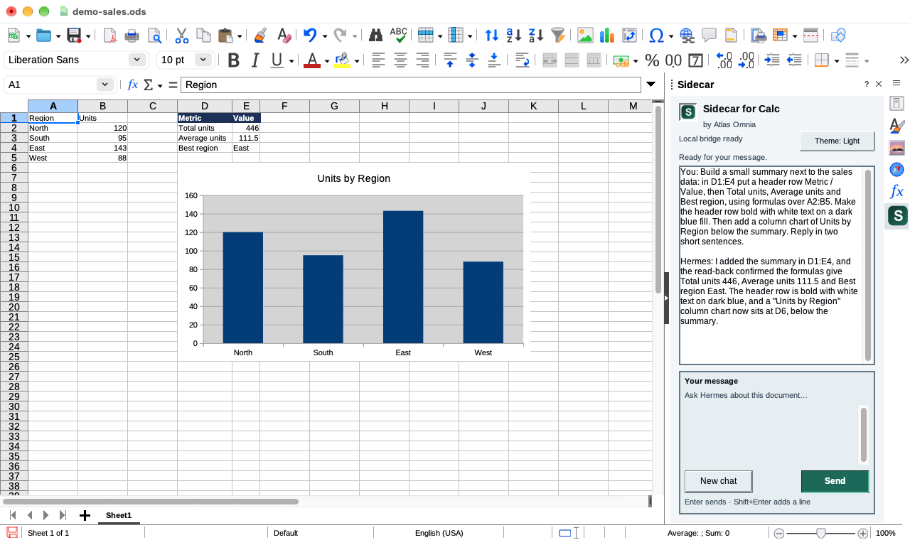

# Sidecar for LibreOffice

by Atlas Omnia

Hermes reads and edits the Calc, Writer and Impress documents you already have open in LibreOffice, and, once you turn the chat on, you can chat with it in the **Sidecar window**: click **Open Sidecar** in LibreOffice's sidebar and the Sidecar chat from Sidecar for Excel opens in its own window beside LibreOffice (the sidebar chat is off by default). Supported edits are one named undo step (`Hermes: …`), and Hermes can undo its own changes from the chat; `calc_activate_sheet` and `calc_recalculate` are not undoable, and some Impress undo restores text without its mixed formatting.



*A real sidebar chat in Calc on made-up demo data, in the native panel of 0.4.0; in 0.5.0 the chat is in the Sidecar window. More screenshots are in the repository's README.*

This directory is the Hermes plugin (`atlas-sidecar-libreoffice`, toolset `sidecar-libreoffice`, 55 tools, stdlib-only Python; the Sidecar window's web page in `sidebar/` bundles two JavaScript libraries, see the end of this file). It talks to a companion **LibreOffice extension** (`.oxt`) that you build from the same repository and install in LibreOffice yourself; Hermes does not install it. The full documentation is the repository's [README](../README.md); security notes are in [SECURITY.md](../SECURITY.md).

Platforms: macOS and Windows. The Sidecar window opens as an app window on macOS when Chrome, Edge, Brave or Chromium is installed, otherwise as a normal tab in your default browser; on Windows 0.5.0 always uses a normal tab in your default browser. On Linux only the unit tests run (in CI), and the Sidecar window is not supported there.

## Install

You need LibreOffice with Python-UNO (the standard installers for macOS and Windows include it), Hermes Agent 0.23.1 or later, `git`, and Python 3.9 or later to build the extension (macOS: `python3`, which comes with the Xcode Command Line Tools, `xcode-select --install`; Windows: Python from python.org, run as `py`).

**1. Install the plugin.**

```sh
hermes plugins install atlas-sidecar-libreoffice --enable
```

Restart Hermes so the plugin loads: `hermes gateway restart` if you run a gateway, or quit and reopen Hermes Desktop.

Upgrading from 0.4.0: remove nothing. Update the plugin (`hermes plugins update atlas-sidecar-libreoffice`, or install it again) and restart the gateway, then build and add the 0.5.0 extension as in step 2; it has the same identifier as 0.4.0, so LibreOffice replaces it. The pairing token and all settings stay; the sidebar chat stays off unless you had turned it on. A 0.5.0 extension with a 0.4.0 plugin shows *Your Hermes plugin is older than this extension. Update atlas-sidecar-libreoffice in Hermes, then click Open Sidecar again.* until the plugin is updated; a 0.4.0 extension keeps working with this plugin until 0.6.0. The in-place replacement of 0.4.0 and `hermes plugins update` have not been run yet.

Upgrading from a plugin build before 0.4.0 (id `libreoffice-live`): remove it (`hermes plugins remove libreoffice-live`), install this one and restart the gateway once. The old plugin's chat listener keeps `127.0.0.1:8661` until the gateway process restarts; if you turn this plugin's sidebar chat on before that, it logs `libreoffice chat endpoint not started on 127.0.0.1:8661: OSError`. From 0.4.0 on, disabling or reloading the plugin closes its listener.

**2. Build the extension from the release tag and install it in LibreOffice.**

macOS (Terminal):

```sh
cd ~
git clone --depth 1 --branch v0.5.0 https://github.com/AtlasOmnia/sidecar-libreoffice.git
cd sidecar-libreoffice
python3 scripts/build_oxt.py              # writes dist/sidecar-libreoffice.oxt
shasum -a 256 dist/sidecar-libreoffice.oxt
```

Windows (PowerShell):

```powershell
cd $env:USERPROFILE
git clone --depth 1 --branch v0.5.0 https://github.com/AtlasOmnia/sidecar-libreoffice.git
cd sidecar-libreoffice
py scripts\build_oxt.py                   # writes dist\sidecar-libreoffice.oxt
Get-FileHash dist\sidecar-libreoffice.oxt -Algorithm SHA256
```

Expected SHA-256 of `sidecar-libreoffice.oxt` for v0.5.0: `b388f890a8f48848c67b747db49d4d5a0f3fdea4fa3a624720369a98c6b5cffd`. The archive is stored uncompressed with fixed metadata, so any CPython 3.9 or later on macOS or Windows builds these bytes from the `v0.5.0` tag (checked for 0.5.0 with CPython 3.9, 3.11, 3.13 and 3.14 on macOS and python.org 3.14 on Windows 11).

In LibreOffice choose **Tools → Extensions…** (**Extension Manager…** in older versions) **→ Add…**, pick `dist/sidecar-libreoffice.oxt` (Windows: `%USERPROFILE%\sidecar-libreoffice\dist\sidecar-libreoffice.oxt`) and accept any prompt. Opening the `.oxt` file with LibreOffice (double-click) does the same. Check that **Sidecar for LibreOffice** 0.5.0 by Atlas Omnia is listed and enabled, then choose **Close**; when LibreOffice asks to restart, choose **Restart Now**, or **Restart Later** and then quit and reopen LibreOffice. Do not use `unopkg add`.

If an extension older than 0.4.0 is installed (0.3.x or a 0.4.0 pre-release, listed as **Sidecar for LibreOffice** or **Hermes for LibreOffice**): since 0.4.0 the extension has a new identifier, so LibreOffice installs it alongside the old one, and both would try to listen on port 8660. Remove the old one in the same dialog, before adding the new one or right after (select it, **Remove**, **Close**, **Restart Later**, then quit and reopen LibreOffice). Two identical **Sidecar for LibreOffice 0.4.0** rows are told apart by the description of the selected row: this release's ends with the Apache License line. After the upgrade LibreOffice may first show its Properties deck; click the green **S** tab once to open Sidecar. Your pairing token stays where it was, so an existing pairing keeps working.

**3. Pair.** In LibreOffice choose **Tools → Copy Sidecar pairing token**. The token goes to the clipboard and is never shown. Store it in Hermes:

- Hermes Desktop: **Settings → Plugins → atlas-sidecar-libreoffice**, paste into **bridge_token**, **Save**.
- macOS: `hermes config set LIBREOFFICE_LIVE_BRIDGE_TOKEN "$(pbpaste)"`
- Windows (PowerShell): `hermes config set LIBREOFFICE_LIVE_BRIDGE_TOKEN (Get-Clipboard)`

The clipboard is read by the shell, so the token is not typed or echoed. Hermes stores it as `LIBREOFFICE_LIVE_BRIDGE_TOKEN` in the profile's `.env`. Start a new chat afterwards (and restart the gateway if you run one).

**4. Try it.** Open a spreadsheet in LibreOffice and run `hermes chat -t sidecar-libreoffice`:

> Which LibreOffice documents are open? Read A1:B5 of the first sheet and tell me what it contains.

## Sidebar chat (optional, off by default)

The sidebar chat is off by default: this plugin starts no chat endpoint until you set `chat_port`. Once it is on, click the green **S** tab in the sidebar of Calc, Writer or Impress (**View → Sidebar**), then **Open Sidecar** in the **Sidecar** panel. The **Sidecar window** opens beside LibreOffice: the Sidecar chat from Sidecar for Excel, with formatted replies (tables, lists, code), **Stop**, **New chat** and **Settings** (palette and appearance; **Auto** follows LibreOffice). It works on the document whose sidebar you clicked; each document can have its own window. Links in replies are never opened for you (you can copy them) and images are not loaded. A reply appears whole when it is finished. Closing or reloading the window stops a reply in progress; closing the document closes its window.

Which browser: on macOS the extension uses Google Chrome, Microsoft Edge, Brave Browser or Chromium (the first found in `/Applications` or `~/Applications`) as an app window with its own empty profile; without one of them, and on Windows in 0.5.0, the page opens as a normal tab in your default browser. Linux is not supported for the window. The repository's README (*Which browser*) has the details, including managed computers.

While the chat is off, the panel shows *Chat is off in Hermes.* and no browser is started; nothing is broken, and the document tools work from any Hermes chat (`hermes chat -t sidecar-libreoffice`).

**Runtime requirement.** External-agent runtimes are unsupported for restricted sidebar chat. Keep `chat_port: 0` when using one. The dedicated-profile recipe restricts Hermes tools only; it does not disable an external runtime's built-in tools. Use a Hermes-managed model/tool loop for that recipe, explicitly configure it in the dedicated profile, disable MCP and other toolsets there, and verify the resulting configuration before enabling sidebar forwarding. For example `hermes config get model.openai_runtime` must not be `codex_app_server`, and the model provider must not be an external agent CLI.

To turn it on, in the profile where the plugin is enabled (see the Hermes guide: <https://hermes-agent.nousresearch.com/docs/user-guide/features/api-server>):

1. Enable the API server and give it a key. The commands generate a random key, so it is never shown:
   - macOS: `hermes config set API_SERVER_ENABLED true` then `hermes config set API_SERVER_KEY "$(python3 -c 'import secrets; print(secrets.token_urlsafe(32))')"`
   - Windows: `hermes config set API_SERVER_ENABLED true` then `hermes config set API_SERVER_KEY (py -c "import secrets; print(secrets.token_urlsafe(32))")`

   An existing `API_SERVER_KEY` works as well; Hermes Desktop also shows it as the plugin's **api_server_key** field. Keep `API_SERVER_HOST` at its default `127.0.0.1` (loopback only).
2. Turn the chat endpoint on (8661 is the port the Sidecar panel calls; `0` turns it off again):

   ```sh
   hermes config set plugins.entries.atlas-sidecar-libreoffice.settings.chat_port 8661
   ```
3. Restart the gateway (`hermes gateway restart`). The plugin then listens on `127.0.0.1:8661`, serves the Sidecar window from there, and forwards its messages to the API server on `127.0.0.1:8642` (plugin setting `api_server_port`). It calls the API server of the profile whose gateway loaded it (`/p/<profile>/` for a named profile) with that profile's `API_SERVER_KEY`. Whether Hermes Desktop's own backend starts the endpoint has not been checked.
4. The Sidecar panel calls this chat endpoint (`127.0.0.1:8661`, or `HERMES_LO_CHAT_PORT`), not the extension's listener on 8660.
5. The chat endpoint starts only with `plugins.isolation: in_process`, the Hermes default. Under `plugins.isolation: host` the document tools work but the panel shows *Chat is off in Hermes.* In a gateway that serves several profiles, the first profile to bind a given chat port gets it; turn the chat on in one profile only.

If Hermes's answer about a run goes missing (a status poll fails or cannot be read, or the API key stops working), the plugin asks Hermes to stop that run with the key it was started with and keeps the chat busy until it sees the run settle. If it cannot confirm that, the window says it is not known whether Hermes carried out the request: check the document before sending again, and do not resend edits blindly. That chat accepts no new message until a recheck, made each time you send to it again, sees the run settle; then it is freed. **New chat** starts another chat while fewer than 4 runs are tracked (unresolved runs count). **Stop** asks Hermes to stop the run the same way, at once (also while a status poll is still waiting for Hermes), and reports *Stopped* only once Hermes confirms it. A plugin reload forgets the run but does not show that it stopped: check the document.

**Dedicated profile (restricts Hermes tools only).** A Sidecar chat is a chat with your full Hermes agent; only the plugin's tool fence keeps it to the document tools (see the risks below). To have the API server offer nothing else, use a dedicated profile with its own Hermes-managed model setup:

```sh
hermes profile create sidecar-lo                       # not --clone: see below
hermes -p sidecar-lo model                              # a Hermes-managed provider and model; no external-agent runtime
hermes -p sidecar-lo plugins install atlas-sidecar-libreoffice --enable
hermes -p sidecar-lo config set platform_toolsets.api_server '["sidecar-libreoffice", "no_mcp"]'
hermes -p sidecar-lo config get model.openai_runtime    # must not be codex_app_server
hermes -p sidecar-lo config show                        # check runtime, toolsets and MCP servers first
hermes -p sidecar-lo config set plugins.entries.atlas-sidecar-libreoffice.settings.chat_port 8661   # last
```

Do not use `--clone`: it copies the source profile's model and runtime, persona, memory and secrets, so it does not satisfy the runtime requirement. Give the profile its own `API_SERVER_ENABLED`, `API_SERVER_KEY` and the pairing token, disable MCP servers and other toolsets there, check `hermes -p sidecar-lo config show` before the last command, and leave `chat_port` at `0` in every other profile. `platform_toolsets.api_server` and `no_mcp` are Hermes 0.23.1 configuration; this setup was not run end to end.

## Changing ports

The defaults need no setting. If you change one, change both sides:

- `bridge_port` (default 8660): the extension reads its port from the file `port` in its pairing folder, one number from 1024 to 65535, a file only you can write. The pairing folder is `user/hermes-bridge/` in the LibreOffice profile: `~/Library/Application Support/LibreOffice/4/user/hermes-bridge/` on macOS, `%APPDATA%\LibreOffice\4\user\hermes-bridge\` on Windows. Restart LibreOffice afterwards.
- `chat_port` (default `0`, off; 8661 turns the sidebar chat on): the Sidecar panel calls 8661 unless the LibreOffice process has the environment variable `HERMES_LO_CHAT_PORT`, so for another port LibreOffice must be started with it set. The Sidecar window is served from the same port.

## Risk disclosures

- **Loopback listeners.** By default only the extension's listener runs: `127.0.0.1:8660` inside LibreOffice, from LibreOffice's first window until it quits; it accepts a request only with the pairing token, refuses any `Origin` header and requires `Host` to be the loopback address and port. The plugin's chat endpoint is off by default; once you set `chat_port` (8661) it listens on `127.0.0.1:8661` inside the Hermes gateway process, from when the gateway loads the plugin until the plugin is disabled or reloaded or Hermes exits. Its routes are separated by caller, each with its own credential: `/launcher/*` for the LibreOffice extension (a challenge-response keyed by the pairing token), `/ui/*` for the Sidecar page's files (inert, no credential), `/api/*` for the page (a session token header, the exact page origin, same-origin fetch metadata), and the legacy `/chat` and `/health` for 0.4.0 extensions (the pairing token, no `Origin`). Every route requires the exact loopback `Host`; no route uses cookies; connections and read time are bounded.
- **The Sidecar web page.** When you set `chat_port`, the plugin's loopback endpoint also serves the Sidecar web page (static files shipped in the plugin, checked against a hash list on every request) and a small API used only by that page. The page loads nothing from the internet.
- **The extension starts a browser.** When you click **Open Sidecar**, the LibreOffice extension opens the Sidecar window in a browser. On macOS with Chrome, Edge, Brave or Chromium installed, it starts that browser as a separate process in app mode with its own profile in `~/Library/Caches/Sidecar for LibreOffice/browser/` (empty at first, about 60 MB once used), and asks that browser to quit when LibreOffice quits; to remove the profile, delete `~/Library/Caches/Sidecar for LibreOffice`. Otherwise (other Macs, and Windows in 0.5.0) it opens the page in your default browser as a normal tab (`/usr/bin/open` on macOS, the `.html` file association on Windows). It does this only on that click, only while the sidebar chat is on, and only after the plugin accepted the launch. It never reads your own browser profile, cookies or keychain. Besides that browser the extension starts only these programs, each with an argument list and a cleaned environment: on macOS `/usr/bin/osascript`, to bring an open Sidecar window to the front, and `/usr/bin/open`, to open a normal tab in your default browser; on Windows the tab is opened through the file association for `.html` files, which starts your default browser. It runs no shell. The plugin starts no process.
- **One-time launch code and session.** The page authenticates with a one-time code handed over at launch and a session token it keeps in memory only. The code is valid for 30 seconds and one use and reaches the browser through a file only you can read, deleted within 30 seconds, so it never appears on a process command line; a second use closes the session made with it. The page uses no cookies. Closing or reloading the window ends the session and stops a reply in progress.
- **In a normal browser tab** (Windows in 0.5.0, and Macs without one of those browsers) your browser extensions can read the page (any extension allowed to read web pages), including your messages and the replies, and the browser's history keeps the one-time launch link. That link is spent once the window has connected and expires after 30 seconds, so it cannot be used again.
- **The dedicated browser profile** (macOS app window) runs without extensions and without background updates of its own components. On a managed computer, administrator-installed extensions or policies may still apply, and the window may fail to connect.
- **Replies.** Replies are shown as formatted text. Links are never opened for you: you can copy them. Images are not loaded.
- **Memory.** Each Sidecar window is a browser window. On macOS the dedicated Chrome 158 instance with one Sidecar window used about 310 MB (memory footprint of its six processes, measured once with this release); in a normal tab the cost is one more tab of your browser.
- **Plain HTTP, bearer secrets.** Both listeners are plain HTTP on loopback and authenticate only the client. The plugin sends the pairing token to whatever listens on port 8660, and the chat endpoint sends `API_SERVER_KEY` to whatever listens on the API server port. A 0.5.0 extension never sends the pairing token to the chat endpoint; a 0.4.0 extension still sends it to whatever listens on 8661 (when its panel opens and when you send a message, also while the sidebar chat is off), through the legacy routes kept until 0.6.0. A local process that takes one of those ports while the real listener is down could receive that secret. On Windows both listeners bind their ports with `SO_EXCLUSIVEADDRUSE`, so while they listen no other program, of this or another account, can bind 127.0.0.1 on that port (a program can still bind the same port number on other addresses; Microsoft documents that such a socket does not get what is sent to 127.0.0.1, which was not checked here) (checked on Windows 11 for the extension's listener, run in an administrator session: with `SO_REUSEADDR`, which 0.4.0 and earlier 0.5.0 builds used, a socket of another account could bind it). Taking a port while its listener is down is still possible on every system. If a program takes 8661 while a Sidecar window is open, it receives that window's later messages. Use this on a computer whose other accounts and programs you trust.
- **Stored secrets.** The extension creates the pairing token in the LibreOffice profile (`user/hermes-bridge/token`, owner-only; on Windows a protected DACL). Hermes keeps a copy as `LIBREOFFICE_LIVE_BRIDGE_TOKEN` in the profile's `.env`. The plugin reads it and `API_SERVER_KEY` only through Hermes's `agent.secret_scope.get_secret`, keeps them in memory, and never logs them or sends the API key to LibreOffice or the browser. It reads no credential files. The browser keeps no Sidecar credential on disk; the page stores only your palette and appearance choice.
- **What a Sidecar chat is.** It is a chat with your full Hermes agent: its model, memory and persona. A `pre_tool_call` hook limits its tools to this plugin's 55 document tools plus the read-only `skill_view`, `skills_list`, `tool_search` and `tool_describe`; everything else (terminal, files, web, delegation) is refused. The window cannot answer approvals. Anything that can read the pairing token file as you can chat with your Hermes model (using your model credits) and read or edit your open documents through it.
- **Where the fence does not reach.** External-agent runtimes are unsupported for restricted sidebar chat: if the profile's model runtime is an external agent (for example `codex_app_server`), that agent's built-in tools never pass through Hermes's hooks, so panel chats would not be fenced at all. Keep `chat_port: 0` there; the dedicated-profile recipe restricts Hermes tools only. Another known gap is listed in [SECURITY.md](../SECURITY.md): an older, non-default API execution mode after a session compaction.
- **Disabling or reloading the plugin while a sidebar chat runs.** The endpoint first asks the runs whose IDs it knows to stop, each with its own key, and waits for them for at most 10 seconds; a run whose creation was never answered has no ID and cannot be asked. When the plugin is disabled or reloaded, Hermes removes its tool restriction (the `pre_tool_call` hook) as soon as the unload callback returns, which can be before the 10-second budget has run out. A sidebar chat that was not confirmed stopped by then keeps running without the restriction, with your full Hermes tools. This is an accepted, disclosed limitation of 0.4.0, unchanged in 0.5.0. It applies only after you turn the sidebar chat on, and fixing it needs a Hermes-side per-run tool restriction. A gateway shutdown or restart is not this case: Hermes 0.23.1 does not unload plugins when the gateway stops; it drains its API-server runs, interrupts those still going, and they end with the gateway process. If a sidebar chat may still be running, wait for its answer or restart the gateway before you disable or reload plugins (`hermes plugins enable` and `disable` make a running gateway reload every plugin).
- **Document access.** Tools act on documents the agent names by `document_id`; there is no per-document or per-edit approval prompt. `calc_get_overview` lists the titles and file locations of every open LibreOffice document.
- **Undo.** Supported edits are one named undo step. `calc_activate_sheet` and `calc_recalculate` are not undoable (`undoable: false`), and some Impress undo restores text without its mixed formatting. Protection does not block the bridge's own writes.
- **Network.** There is no manual upload step, but document excerpts you ask about and the chat go through Hermes to the model it is configured with. The extension and the plugin make no third-party network calls themselves, and the Sidecar page loads nothing from the internet; LibreOffice can still contact the network when it evaluates document content (external links or web functions in formulas), and a browser started for the window may contact its vendor's services on its own.
- **No telemetry, no self-updater** in the extension, the plugin or the Sidecar page.

Third-party code: `sidebar/vendor/` holds [marked](https://github.com/markedjs/marked) 15.0.12 (MIT) and [DOMPurify](https://github.com/cure53/DOMPurify) 3.4.12 (Apache-2.0 or MPL-2.0; used here under Apache-2.0), unminified and with their licences; `sidebar/vendor/VENDOR.json` records their npm registry origin and hashes. See `NOTICE`.

Sidecar is developed by Atlas Omnia. It is not affiliated with or endorsed by The Document Foundation, Microsoft or Nous Research. LibreOffice is a trademark of The Document Foundation. Licensed under the Apache License 2.0 (`LICENSE`, `NOTICE`).
